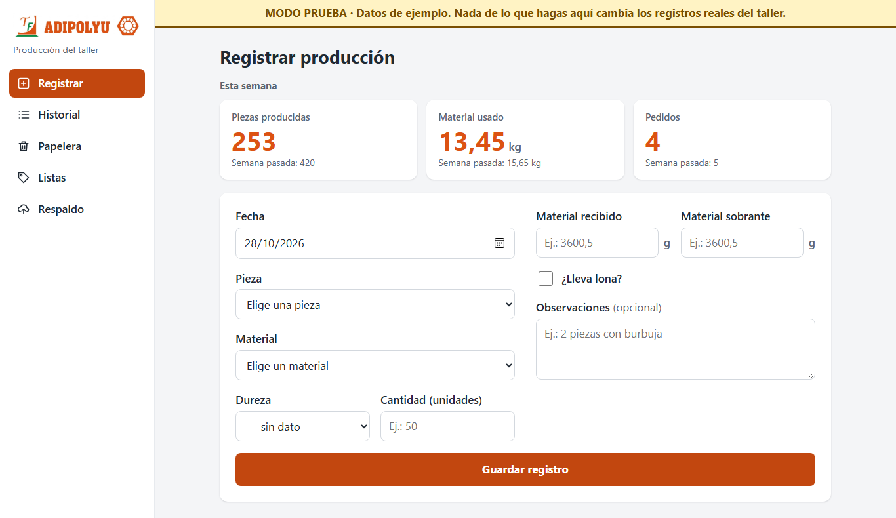
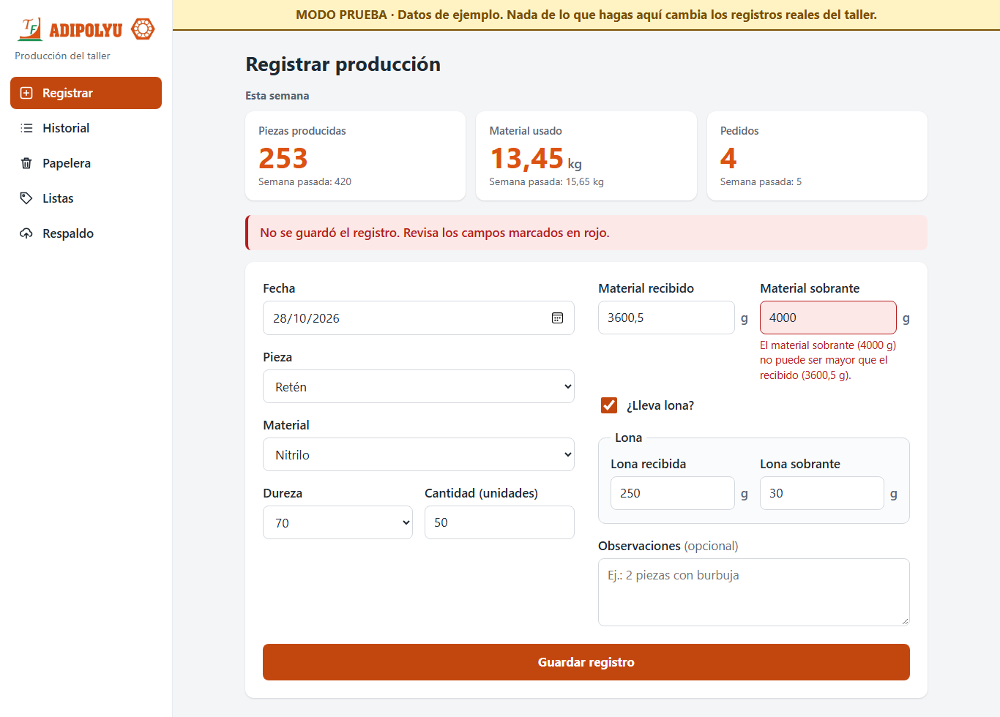
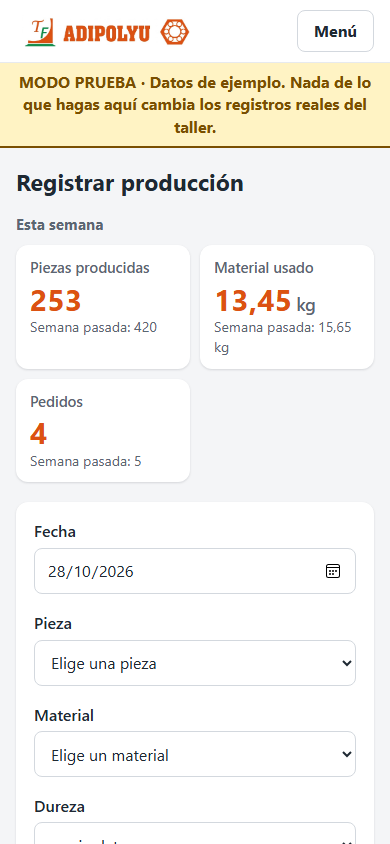
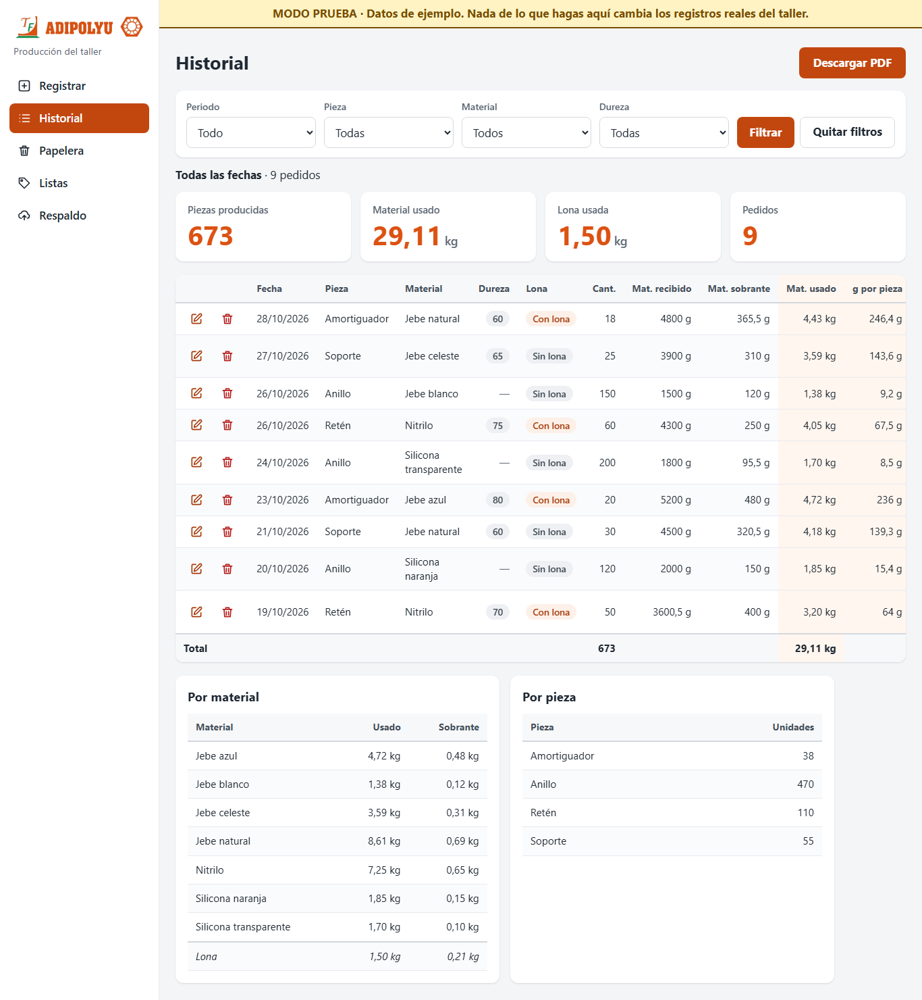
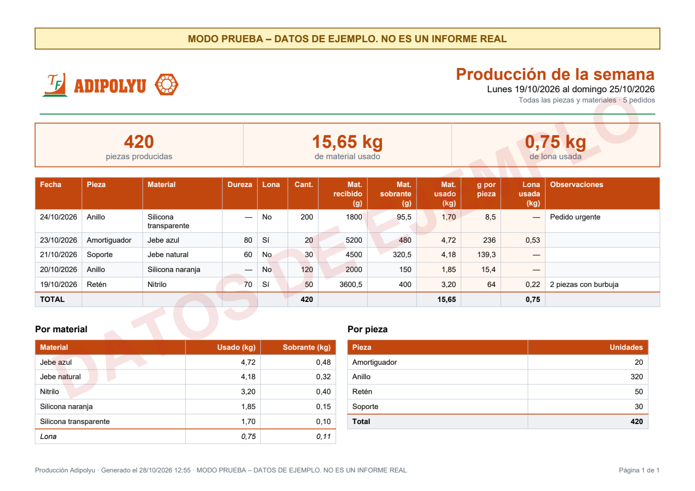
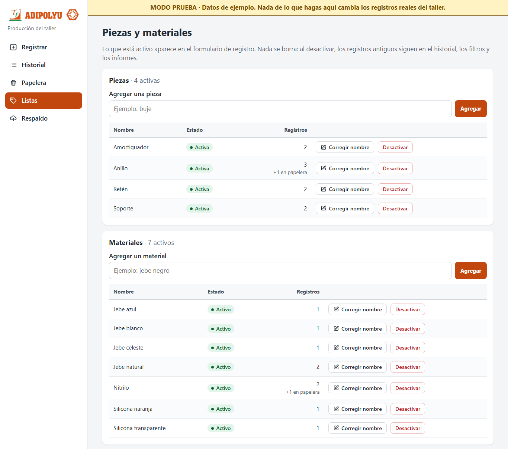

# Producción Adipolyu

App web local para registrar la producción del taller de piezas de jebe y silicona **Adipolyu E.I.R.L.** (Lima, Perú) y generar informes semanales en PDF.

En el taller, el material se carga en moldes metálicos calentados y se prensa. Cada pedido se registra con la pieza, el material, la dureza, si lleva lona, las unidades producidas y lo que se pesó en la balanza: material recibido y material sobrante, en gramos. La app calcula el material usado, el consumo por pieza y los totales de la semana.



> Todas las capturas usan el **modo prueba**, con datos de ejemplo inventados (franja amarilla). Los registros reales del taller no se publican.

## Qué hace

- **Registrar producción.** Un registro corresponde a un pedido. La fecha es libre, para poder registrar días pasados, pero no se aceptan fechas futuras. Los pesos se escriben en gramos con coma o punto decimal, y los datos de lona solo se piden cuando el pedido lleva lona. Arriba del formulario se ven las cifras de la semana.
- **Validar antes de guardar.** El sobrante no puede ser mayor que lo recibido, la cantidad tiene que ser mayor que 0 y la lona es obligatoria si se marcó. Cada error aparece junto a su campo.
- **Historial** en tabla. Se puede filtrar por semana, rango de fechas, pieza, material y dureza, y muestra totales por material y por pieza. Los registros se corrigen con el mismo formulario.
- **Papelera.** Un registro borrado se puede recuperar.
- **Informe en PDF** (A4 horizontal) del periodo y los filtros que se están viendo: logo, cifras principales, tabla de detalle y resúmenes por material y por pieza.
- **Listas de piezas y materiales** editables desde la app. Se pueden agregar nombres, corregirlos, desactivarlos o reactivarlos. Nunca se borran, para no romper los registros antiguos.
- **Respaldo** con un botón. Copia la base a una carpeta de Google Drive para escritorio, la verifica comparando huellas SHA-256 y avisa si pasaron más de 7 días desde el último respaldo.
- **Modo prueba.** Usa una base aparte con datos de ejemplo, en otro puerto y con una franja amarilla. Sirve para practicar o para mostrar la app sin tocar los datos reales.

## Capturas

| Validación por campo | Vista en celular |
|---|---|
|  |  |

**Historial con filtros y totales**



**Informe semanal en PDF** (en modo prueba lleva la marca de agua "DATOS DE EJEMPLO")



**Piezas y materiales**



## Instalación (Windows)

Requisito: Python 3.12.

```powershell
git clone https://github.com/xOnigiri/produccion-adipolyu.git
cd produccion-adipolyu
py -m venv .venv
.venv\Scripts\python -m pip install -r requirements.txt
.venv\Scripts\python crear_base.py
```

`crear_base.py` crea `produccion.db` con las tablas y las listas iniciales de piezas y materiales. Se puede ejecutar de nuevo sin riesgo: no borra ni duplica datos.

## Uso

- **App real:** doble clic en `Iniciar app.bat`. Se abre el navegador en http://127.0.0.1:5000. La ventana negra tiene que quedar abierta mientras se usa la app.
- **Modo prueba:** doble clic en `Iniciar modo prueba.bat`. Se abre en http://127.0.0.1:5001 con `produccion_prueba.db`, que se crea sola con datos de ejemplo. Para volver a los datos iniciales, basta con borrar ese archivo.

La app solo escucha en `127.0.0.1`, así que solo se puede abrir desde la misma computadora.

El respaldo se guarda en `G:\Mi unidad\ADIPOLYU\respaldos-produccion\` (Google Drive para escritorio). Para otra carpeta, se cambia `CARPETA_DRIVE` en `respaldo.py`. La app nunca escribe fuera de esa carpeta.

## Cómo se guardan los datos

- **SQLite.** Un solo archivo, `produccion.db`, con tres tablas: `piezas`, `materiales` y `produccion`.
- **Se guardan solo los datos medidos.** Los valores derivados se calculan cada vez que se muestran, así que corregir un dato actualiza todo lo demás:
  - material usado = recibido − sobrante;
  - lona usada;
  - gramos por pieza;
  - kg;
  - semana (de lunes a domingo).
- **Reglas en tres niveles:** en el navegador, en el servidor y con restricciones `CHECK` en la base.
- **Un solo módulo para el redondeo.** Todas las cifras pasan por `formato.py`, y los valores terminados en 5 suben (0,745 → 0,75). Así la pantalla y el PDF siempre muestran lo mismo.
- **Las bases y los respaldos no se suben al repositorio** (`.gitignore`).

## Estructura

| Archivo | Qué hace |
|---|---|
| `app.py` | Páginas y rutas (Flask) |
| `base_datos.py` | Consultas a SQLite |
| `crear_base.py` | Crea o actualiza la base sin borrar datos |
| `validacion.py` | Reglas de los formularios |
| `calculos.py` | Material usado, totales, semanas |
| `formato.py` | Redondeo, coma decimal, fechas y nombres |
| `informe_pdf.py` | Informe en PDF (ReportLab) |
| `respaldo.py` | Respaldo verificado a Google Drive |
| `datos_prueba.py` | Datos de ejemplo del modo prueba |
| `templates/`, `static/` | Páginas HTML, estilos, JavaScript e iconos |
| `tests/` | Pruebas automáticas |
| `docs/` | Recorrido del código por partes y capturas |

## Tecnologías

- Python 3.12
- [Flask](https://flask.palletsprojects.com/) 3.1
- SQLite (incluido en Python)
- [ReportLab](https://www.reportlab.com/opensource/) 5.1 y [Pillow](https://python-pillow.org/) 13.0, para el PDF
- HTML, CSS y JavaScript sin frameworks

## Pruebas

```powershell
.venv\Scripts\python -m unittest
```

Son 204 pruebas automáticas que cubren validación, cálculos y redondeo, historial, papelera, listas, informe PDF, respaldo y diseño. Corren siempre sobre bases temporales y nunca abren `produccion.db`.

## Cómo se desarrolló

La app se construyó por partes, cada una probada y aprobada antes de pasar a la siguiente. El historial de commits muestra ese orden, y [`docs/`](docs/) explica el código de cada parte en lenguaje sencillo.

**Desarrollada con asistencia de IA.** El código lo escribió Claude (Anthropic). Los requisitos, las decisiones sobre qué datos registrar, las pruebas de cada parte y la aprobación están a cargo de Fabian Fernandez, que la usa en el taller.

## Licencia

El código está bajo licencia [MIT](LICENSE).

**El logo y el nombre "Adipolyu" no están incluidos en esa licencia.** Pertenecen a Adipolyu E.I.R.L., con todos los derechos reservados. Esto incluye `logo-adipolyu.png`, `static/icono.png` y el logo que aparece en las capturas. Si reutilizas el código, reemplázalos por tu propio logo y nombre.
